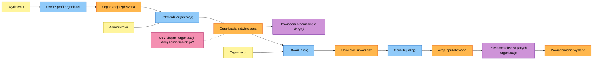

# Event storming: szkic do sesji zespołu

Szkic przygotowany na podstawie [założeń](za%C5%82o%C5%BCenia.md) jako punkt wyjścia do sesji event stormingu. Prowadzący WDZPD wymaga udokumentowanej sesji, więc na zajęciach przechodzimy przez ten szkic razem (np. w Miro), poprawiamy go i uzupełniamy, a na koniec dopisujemy sekcję [Po sesji](#po-sesji) ze zrzutem tablicy.

Legenda (kolory karteczek z szablonu laboratorium):

| Kolor | Element | Przykład |
|---|---|---|
| żółty | aktor | Wolontariusz |
| niebieski | komenda | Zapisz się na akcję |
| pomarańczowy | zdarzenie domenowe (czas przeszły) | Zgłoszenie złożone |
| fioletowy | polityka („gdy X, to Y”) | Gdy zwolni się miejsce, awansuj pierwszego z listy rezerwowej |
| zielony | widok (dane potrzebne do decyzji) | Mapa akcji z filtrami |
| czerwony | system zewnętrzny | Google (logowanie) |
| różowy | gorący punkt (pytanie, problem) | Do kiedy można się wycofać? |

## Główne procesy

### Organizacja i publikacja akcji

### Zapis, realizacja i potwierdzenie udziału

```mermaid
flowchart LR
  classDef aktor fill:#fff59d,stroke:#b8a200,color:#000
  classDef komenda fill:#90caf9,stroke:#1565c0,color:#000
  classDef zdarzenie fill:#ffb74d,stroke:#e65100,color:#000
  classDef polityka fill:#ce93d8,stroke:#6a1b9a,color:#000
  classDef problem fill:#f48fb1,stroke:#ad1457,color:#000

  w1["Wolontariusz"]:::aktor --> k1["Zapisz się na akcję"]:::komenda
  k1 -- "jest miejsce" --> z1["Zgłoszenie złożone"]:::zdarzenie
  k1 -- "limit wyczerpany" --> z2["Zgłoszenie na liście rezerwowej"]:::zdarzenie
  o1["Organizator"]:::aktor --> k2["Zatwierdź zgłoszenie"]:::komenda
  z1 --> k2
  k2 --> z3["Zgłoszenie zatwierdzone"]:::zdarzenie
  z3 --> k3["Wycofaj zgłoszenie"]:::komenda
  k3 --> z4["Zgłoszenie wycofane"]:::zdarzenie
  z4 --> p1["Zwolnione miejsce: awansuj pierwszego z listy rezerwowej"]:::polityka
  z2 --> p1
  p1 --> z5["Wolontariusz awansowany z listy rezerwowej"]:::zdarzenie
  h1["Awansowany od razu zatwierdzony czy czeka na organizatora?"]:::problem -.- z5
  z3 --> p2["Po terminie: zakończ akcję"]:::polityka
  p2 --> z6["Akcja zakończona"]:::zdarzenie
  z6 --> k4["Oznacz obecność"]:::komenda
  k4 --> z7["Obecność oznaczona"]:::zdarzenie
  z7 --> k5["Wystaw potwierdzenie"]:::komenda
  k5 --> z8["Potwierdzenie wystawione"]:::zdarzenie
  z8 --> p3["Wygeneruj PDF i powiadom wolontariusza"]:::polityka
  p3 --> z9["PDF potwierdzenia wygenerowany"]:::zdarzenie
```

## Zdarzenia, komendy i aktorzy

Kolejność w tabelach jest chronologiczna w obrębie każdego obszaru. „System” oznacza komendę wywołaną przez politykę albo upływ czasu.

### Konta i profil

| Aktor | Komenda | Zdarzenie |
|---|---|---|
| Gość | Zarejestruj konto e-mailem | Konto założone |
| System | Wyślij link aktywacyjny | Link aktywacyjny wysłany |
| Gość | Potwierdź adres e-mail | Adres e-mail potwierdzony |
| Gość | Zaloguj się przez Google | Konto założone przez Google |
| Użytkownik | Poproś o reset hasła | Reset hasła zlecony |
| Użytkownik | Ustaw nowe hasło | Hasło zmienione |
| Wolontariusz | Uzupełnij umiejętności, rodzaje wolontariatu i obszar | Profil zaktualizowany |
| Wolontariusz | Udziel albo wycofaj zgodę (lokalizacja, powiadomienia) | Zgoda udzielona / Zgoda wycofana |
| Wolontariusz | Pobierz swoje dane | Dane wyeksportowane |
| Wolontariusz | Usuń konto | Konto usunięte |

### Organizacje

| Aktor | Komenda | Zdarzenie |
|---|---|---|
| Użytkownik | Utwórz profil organizacji | Organizacja zgłoszona (status: oczekująca) |
| Administrator | Zatwierdź organizację | Organizacja zatwierdzona |
| Administrator | Odrzuć organizację z uzasadnieniem | Organizacja odrzucona |
| Administrator | Zablokuj albo odblokuj organizację | Organizacja zablokowana / Organizacja odblokowana |
| Organizator | Dodaj członka zespołu (opcjonalne) | Członek zespołu dodany |
| Wolontariusz | Obserwuj organizację / Przestań obserwować | Organizacja zaobserwowana / Obserwowanie zakończone |

### Akcje

| Aktor | Komenda | Zdarzenie |
|---|---|---|
| Organizator | Utwórz akcję | Szkic akcji utworzony |
| System | Ustal współrzędne adresu | Adres akcji zgeokodowany |
| Organizator | Opublikuj akcję | Akcja opublikowana |
| Organizator | Zmień termin albo miejsce | Termin akcji zmieniony / Miejsce akcji zmienione |
| Organizator | Zmień limit uczestników | Limit uczestników zmieniony |
| Organizator | Anuluj akcję | Akcja anulowana |
| Organizator | Usuń akcję | Akcja usunięta |
| System | Zakończ akcję po terminie | Akcja zakończona |

### Zapisy

| Aktor | Komenda | Zdarzenie |
|---|---|---|
| Wolontariusz | Zapisz się na akcję | Zgłoszenie złożone / Zgłoszenie na liście rezerwowej / Zapis odrzucony (kolizja terminów albo podwójny zapis) |
| Organizator | Zatwierdź zgłoszenie | Zgłoszenie zatwierdzone |
| Organizator | Odrzuć zgłoszenie z komentarzem | Zgłoszenie odrzucone |
| Wolontariusz | Wycofaj zgłoszenie | Zgłoszenie wycofane |
| System | Awansuj pierwszego z listy rezerwowej | Wolontariusz awansowany z listy rezerwowej |
| System | Wyślij przypomnienie przed akcją | Przypomnienie wysłane |

### Realizacja i potwierdzenia

| Aktor | Komenda | Zdarzenie |
|---|---|---|
| Organizator | Oznacz obecność uczestnika | Obecność oznaczona / Nieobecność oznaczona |
| Organizator | Skoryguj liczbę godzin | Liczba godzin skorygowana |
| Organizator | Wystaw potwierdzenie udziału | Potwierdzenie wystawione |
| System | Wygeneruj PDF potwierdzenia | PDF potwierdzenia wygenerowany |
| Organizator | Skoryguj potwierdzenie | Potwierdzenie unieważnione, nowa wersja wystawiona |
| Gość | Zweryfikuj potwierdzenie po numerze lub kodzie | Potwierdzenie zweryfikowane |

### Powiadomienia i administracja

| Aktor | Komenda | Zdarzenie |
|---|---|---|
| Użytkownik | Ustaw kanały i częstotliwość powiadomień | Preferencje powiadomień zmienione |
| System | Wyślij powiadomienie (z polityk poniżej) | Powiadomienie utworzone / E-mail wysłany / Wysyłka e-maila nieudana |
| Administrator | Zablokuj albo odblokuj użytkownika | Użytkownik zablokowany / Użytkownik odblokowany |
| Administrator | Zmień rolę użytkownika | Rola zmieniona |
| Administrator | Zmień słownik umiejętności albo rodzajów wolontariatu | Słownik zmieniony |

## Polityki

| Gdy | to |
|---|---|
| Konto założone (e-mailem) | wyślij link aktywacyjny |
| Organizacja zatwierdzona albo odrzucona | powiadom organizację (przy odrzuceniu z uzasadnieniem) |
| Zapisano adres akcji, organizacji albo obszar wolontariusza | ustal współrzędne (geokodowanie) |
| Akcja opublikowana | powiadom obserwujących organizację, od razu albo w podsumowaniu, według ich preferencji |
| Zapis na akcję, a limit wyczerpany | dodaj zgłoszenie na koniec listy rezerwowej |
| Zgłoszenie zatwierdzone albo odrzucone | powiadom wolontariusza |
| Zgłoszenie wycofane albo odrzucone, limit zwiększony | awansuj pierwszego z listy rezerwowej i powiadom go |
| Zmieniono termin albo miejsce akcji | powiadom zapisanych |
| Akcja anulowana | zamknij zgłoszenia i listę rezerwową, powiadom zapisanych |
| Zbliża się termin akcji | wyślij przypomnienie zatwierdzonym uczestnikom |
| Minął termin zakończenia akcji | oznacz akcję jako zakończoną i przypomnij organizatorowi o obecnościach |
| Obecność oznaczona | dolicz godziny (domyślnie czas trwania akcji) do historii wolontariusza i statystyk organizacji |
| Potwierdzenie wystawione | wygeneruj PDF w tle i powiadom wolontariusza |
| Użytkownik zablokowany | odwołaj jego refresh tokeny |
| Dowolne zdarzenie biznesowe | zapisz w logach aplikacji |

## Widoki

- Lista i mapa akcji z filtrami (gość, wolontariusz).
- Szczegóły akcji: wolne miejsca, status zgłoszenia, pozycja na liście rezerwowej.
- Rekomendowane akcje z powodem rekomendacji (strona główna wolontariusza).
- Historia aktywności i suma godzin z filtrem okresu.
- Moje potwierdzenia z pobieraniem PDF.
- Zgłoszenia do akcji i lista rezerwowa (organizator).
- Lista obecności (organizator).
- Panel statystyk organizacji: unikalni wolontariusze, frekwencja, godziny, z filtrem okresu i akcji.
- Kolejka organizacji oczekujących na weryfikację (administrator).
- Logi aplikacji z filtrami (administrator).
- Publiczna weryfikacja potwierdzenia.
- Powiadomienia użytkownika.

## Systemy zewnętrzne

- Google: logowanie przez OAuth 2.0 / OIDC.
- Serwer SMTP: wysyłka e-maili.
- Nominatim: geokodowanie adresów.
- Serwery kafelków OpenStreetMap: podkład mapy.
- Przeglądarka: geolokalizacja za zgodą użytkownika.

## Agregaty

| Agregat | Pilnuje reguł |
|---|---|
| Konto użytkownika (profil, zgody, preferencje, obserwowane organizacje) | unikalny e-mail, aktywacja konta, zgody RODO |
| Organizacja (z członkami zespołu) | publikować akcje może tylko zatwierdzona i niezablokowana organizacja |
| Akcja | statusy: szkic, opublikowana, zakończona, anulowana; zmiany tylko przez organizację-właściciela |
| Lista uczestników akcji (zgłoszenia i lista rezerwowa) | zatwierdzonych nie więcej niż limit, kolejność listy rezerwowej, brak podwójnego zapisu; zapis i awans w jednej transakcji |
| Potwierdzenie udziału | unikalny numer, niezmienne po wystawieniu, korekta jako nowa wersja |
| Słowniki (umiejętności, rodzaje wolontariatu) | zmienia tylko administrator |

## Konteksty ograniczone

Propozycja podziału na moduły backendu ([ADR-001](adr/001-architektura-spa-i-rest-api.md)):

| Kontekst | Agregaty | Uwagi |
|---|---|---|
| Konta i profil | Konto użytkownika | logowanie, role, zgody, eksport i usunięcie danych |
| Organizacje | Organizacja | weryfikacja przez administratora, obserwowanie |
| Akcje | Akcja | tworzenie, publikacja, wyszukiwanie z mapą |
| Zapisy | Lista uczestników akcji | lista rezerwowa, kolizje terminów, przypomnienia |
| Realizacja i potwierdzenia | Potwierdzenie udziału | obecności, godziny, PDF, publiczna weryfikacja |
| Powiadomienia | (brak własnych reguł) | reaguje na zdarzenia z pozostałych kontekstów |
| Rekomendacje i statystyki | (tylko odczyt) | widoki liczone z danych pozostałych kontekstów |
| Administracja | Słowniki | użytkownicy, organizacje, logi |

## Gorące punkty

Pytania, na które założenia nie odpowiadają jednoznacznie. Każde rozstrzygnięcie zmienia model danych albo reguły, więc warto je zamknąć przed pisaniem user stories.

1. **Limit a zgłoszenia oczekujące.** Limit liczy się względem zatwierdzonych (2.6). Co dzieje się ze zgłoszeniami oczekującymi, gdy organizator zatwierdzi już komplet: trafiają na listę rezerwową czy zostają odrzucone?
2. **Awans z listy rezerwowej.** Czy awansowany jest od razu zatwierdzony, czy czeka na decyzję organizatora? Co, jeśli w międzyczasie zapisał się na kolidującą akcję?
3. **Kolizja terminów.** Ostrzeżenie czy blokada (założenia dopuszczają oba)? Propozycja: blokada podwójnego zapisu na tę samą akcję, ostrzeżenie przy kolizji z inną akcją.
4. **Wycofanie zgłoszenia.** Do kiedy można się wycofać, np. najpóźniej 24 godziny przed akcją?
5. **Usuwanie akcji.** Czy usunąć można tylko szkic, a opublikowaną z zapisami tylko anulować?
6. **Zmniejszenie limitu.** Co, jeśli organizator zmniejszy limit poniżej liczby zatwierdzonych?
7. **Zakończenie akcji.** Automatycznie po terminie czy ręcznie przez organizatora? Ile czasu ma organizator na oznaczenie obecności?
8. **Potwierdzenia.** Czy można je wystawić tylko obecnym? Jedno na wolontariusza i akcję?
9. **Usunięcie konta.** Co z historią, statystykami organizacji i wystawionymi potwierdzeniami po usunięciu konta wolontariusza (RODO a weryfikacja potwierdzeń)? Propozycja: anonimizacja zamiast usuwania.
10. **Blokada organizacji.** Co z jej opublikowanymi akcjami i zapisami: ukryć, anulować, zostawić?
11. **Konto z Google i konto e-mailowe.** Czy łączyć je automatycznie przy tym samym, zweryfikowanym adresie?
12. **Członkowie zespołu organizacji.** Założenia oznaczają to jako opcjonalne. Robimy w pierwszej wersji czy później? To zmienia model uprawnień.
13. **Publiczna weryfikacja potwierdzenia.** Jakie dane pokazujemy, żeby było to „minimum” z 3.3?

## Słownik pojęć

| Pojęcie | Znaczenie |
|---|---|
| Akcja | wydarzenie wolontariackie organizacji z terminem, miejscem i limitem uczestników |
| Zgłoszenie | zapis wolontariusza na akcję; ma status: oczekujące, zatwierdzone, odrzucone, wycofane, na liście rezerwowej |
| Lista rezerwowa | kolejka zgłoszeń ponad limit, w kolejności zapisu |
| Awans | przeniesienie pierwszego zgłoszenia z listy rezerwowej na zwolnione miejsce |
| Obecność | potwierdzenie przez organizatora, że uczestnik faktycznie był na akcji, wraz z liczbą godzin |
| Potwierdzenie udziału | dokument PDF z unikalnym numerem, wystawiany przez organizatora |
| Organizator | użytkownik działający w imieniu zatwierdzonej organizacji |
| Obszar zainteresowania | miasto albo punkt na mapie z promieniem, w którym wolontariusz szuka akcji |

## Po sesji

Do uzupełnienia po zajęciach:
- data, uczestnicy i narzędzie (np. link do tablicy w Miro);
- zrzut tablicy;
- zmiany względem szkicu: co dodaliśmy, co usunęliśmy;
- rozstrzygnięcia gorących punktów; pozostałe pytania jako issues w repozytorium;
- lista zdarzeń jako podstawa backlogu i user stories.
